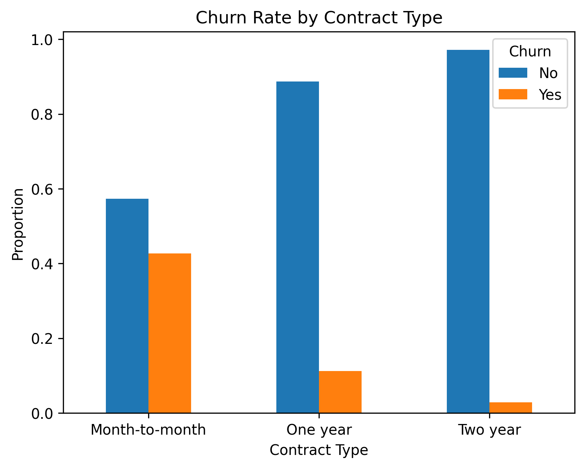
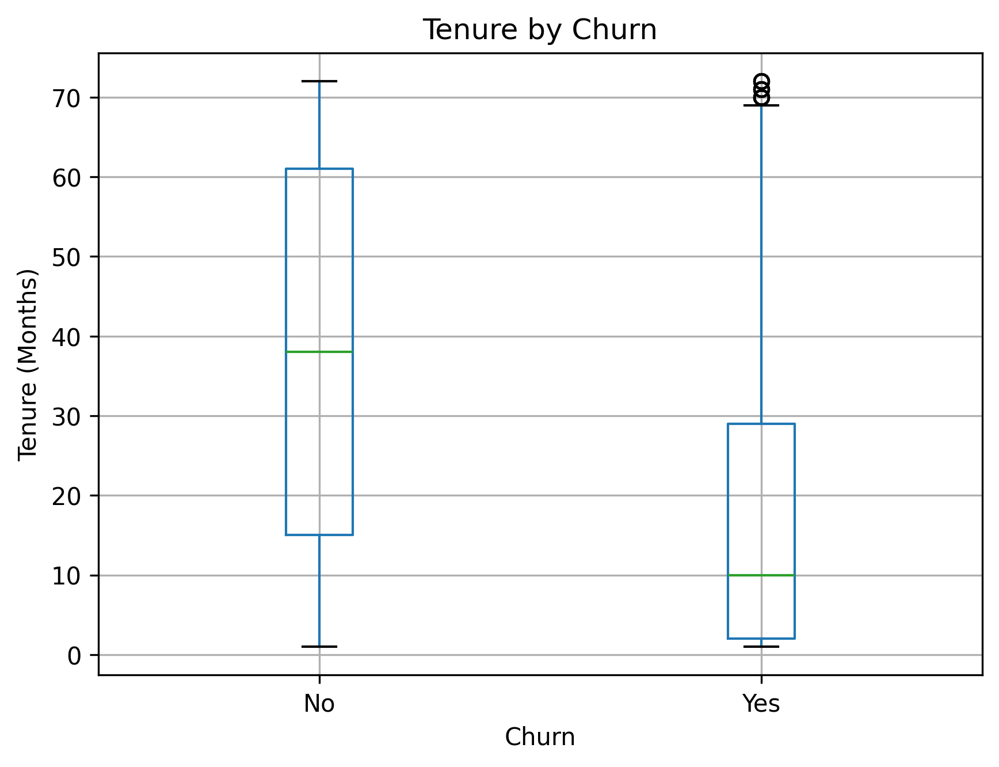
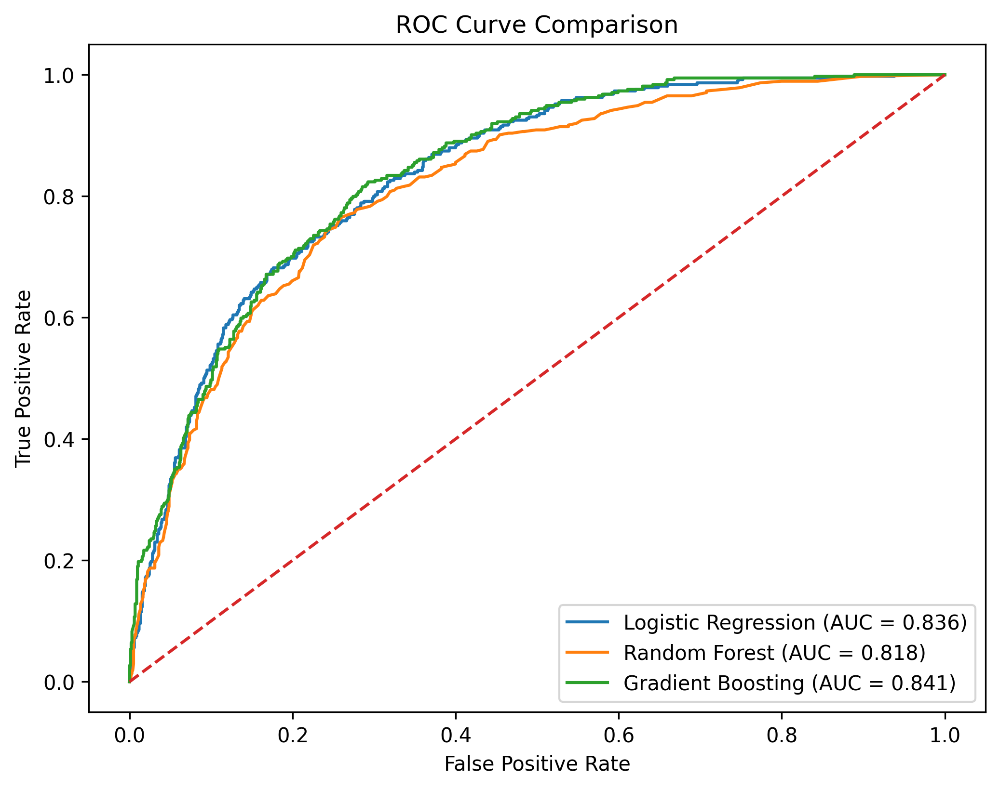
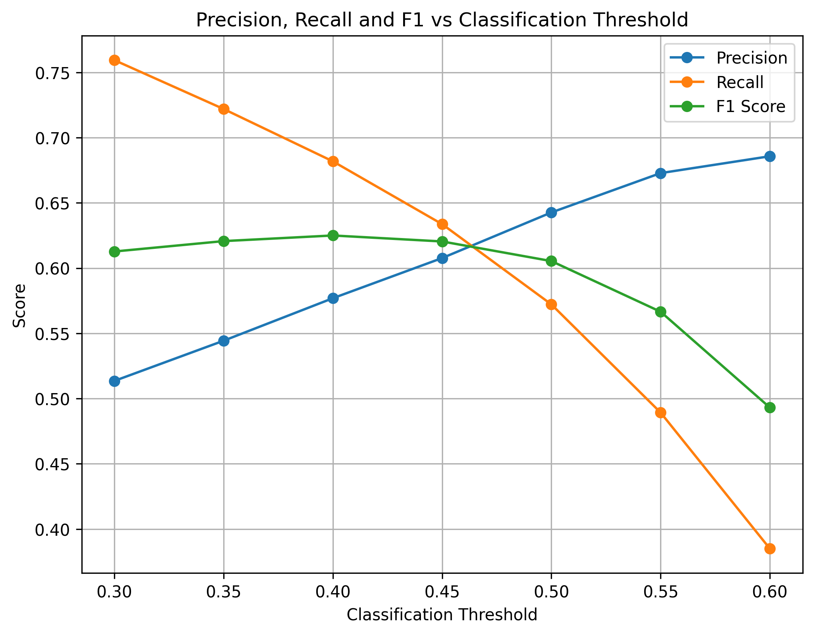
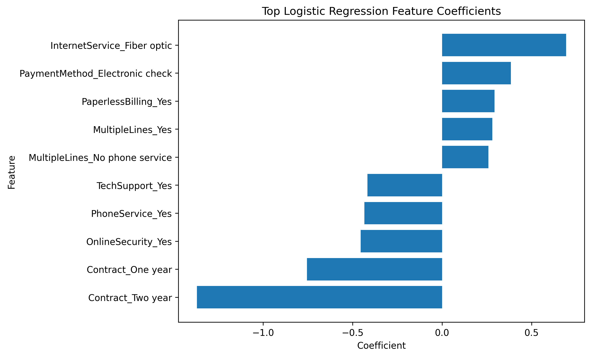
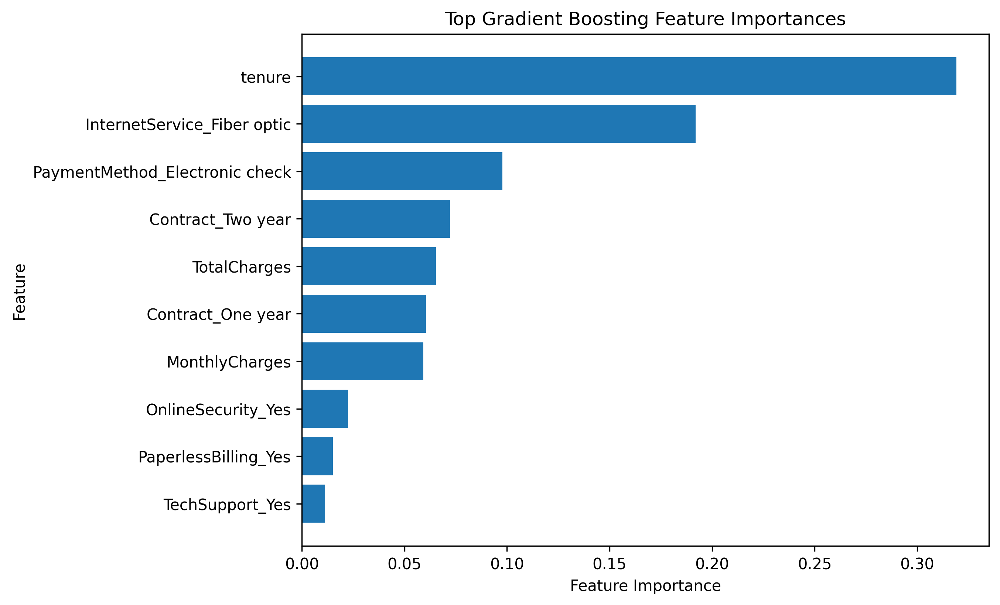
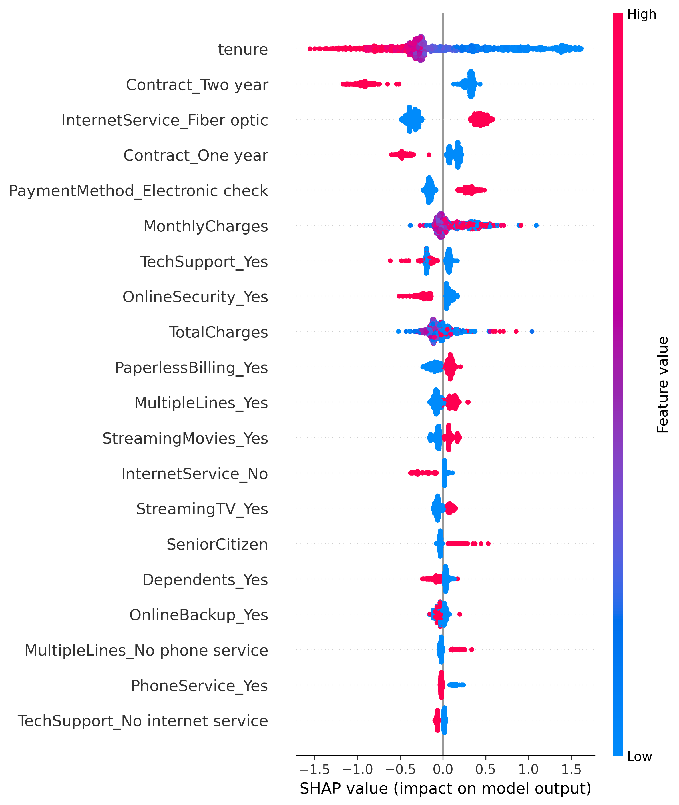

# Customer Churn Prediction

## Project Overview

This project develops a machine learning pipeline to predict customer churn for a telecommunications company. The goal is to identify customers who are at higher risk of leaving the service and explore the factors associated with customer churn.

The project covers the complete machine learning workflow, including data cleaning, exploratory data analysis, feature engineering, model training, model evaluation, threshold tuning, and model interpretation.

---

## Business Problem

Customer churn can lead to revenue loss and increased customer acquisition costs. A churn prediction model can help a company identify high-risk customers in advance and support targeted retention strategies.

This project focuses on the following questions:

- What customer characteristics are associated with higher churn rates?
- Which machine learning model performs best for churn prediction?
- Can classification threshold tuning improve the identification of churn customers?
- Which features contribute most strongly to the model's predictions?

---

## Dataset

The project uses the Telco Customer Churn dataset.

The original dataset contains:

- 7,043 customer records
- 21 variables
- Customer demographics
- Service subscriptions
- Contract information
- Payment methods
- Monthly and total charges
- Customer churn status

The target variable is:

- `Churn = 1`: customer churned
- `Churn = 0`: customer did not churn

After data cleaning, 7,032 customer records were used for modelling.

---

## Data Preprocessing

The following preprocessing steps were performed:

- Converted `TotalCharges` from text to numeric values
- Identified and removed 11 records with missing `TotalCharges`
- Removed `customerID` because it does not provide predictive information
- Converted the target variable `Churn` into binary values
- Applied one-hot encoding to categorical variables
- Split the dataset into 80% training data and 20% testing data
- Used stratified sampling to preserve the churn class distribution

After encoding, the model input contained 30 features.

---

## Exploratory Data Analysis

Several important patterns were identified during exploratory data analysis.

### Contract Type

Customers on month-to-month contracts showed substantially higher churn rates than customers on one-year or two-year contracts.



### Customer Tenure

Customers with shorter tenure showed much higher churn rates, while long-term customers were less likely to churn.



Additional analysis suggested that fiber optic internet users also showed a relatively high churn rate. Customers with medium-to-high monthly charges had higher churn rates overall, although this relationship appeared to be partially associated with internet service type.

---

## Machine Learning Models

Three classification models were trained and compared:

1. Logistic Regression
2. Random Forest
3. Gradient Boosting

The same training and testing data were used for all three models to ensure a consistent comparison.

---

## Model Evaluation

The models were evaluated using Accuracy, Precision, Recall, F1-score, and ROC-AUC.

| Model | Accuracy | ROC-AUC | Precision (Churn) | Recall (Churn) | F1 (Churn) |
|---|---:|---:|---:|---:|---:|
| Logistic Regression | 0.802 | 0.836 | 0.643 | 0.572 | 0.605 |
| Random Forest | 0.787 | 0.818 | 0.623 | 0.508 | 0.560 |
| Gradient Boosting | 0.796 | 0.841 | 0.641 | 0.529 | 0.580 |

Gradient Boosting achieved the highest ROC-AUC, while Logistic Regression produced the strongest churn recall and F1-score at the default classification threshold.

### ROC Curve



---

## Classification Threshold Tuning

The default classification threshold of 0.50 was adjusted to explore the trade-off between precision and recall.

For Logistic Regression, reducing the threshold from 0.50 to 0.40:

- Increased churn recall from 0.572 to 0.682
- Increased churn F1-score from 0.605 to 0.625
- Reduced precision from 0.643 to 0.577
- Reduced overall accuracy from 0.802 to 0.783

A threshold of 0.40 achieved the highest F1-score among the tested thresholds and provided a better balance between precision and recall for churn detection.



---

## Model Interpretation

### Logistic Regression

Logistic Regression coefficients showed that fiber optic internet, electronic check payment, and paperless billing were associated with a higher predicted probability of churn.

Longer-term contracts, technical support, and online security were associated with lower predicted churn risk.



### Gradient Boosting

Gradient Boosting identified customer tenure as the most important predictive feature, followed by fiber optic internet service and electronic check payment.

Contract type, total charges, and monthly charges also contributed substantially to the model.



### SHAP Analysis

SHAP analysis was used to examine both feature importance and the direction of feature contributions.

The results indicated that:

- Short tenure increased predicted churn risk
- Fiber optic internet increased predicted churn risk
- Electronic check payment increased predicted churn risk
- Longer tenure reduced predicted churn risk
- One-year and two-year contracts reduced predicted churn risk
- Technical support and online security generally reduced predicted churn risk



---

## Key Findings

The main findings from the project are:

- Customers with shorter tenure are substantially more likely to churn
- Month-to-month contracts are strongly associated with higher churn
- Fiber optic internet customers show higher churn risk
- Electronic check payment is associated with higher predicted churn risk
- Longer-term contracts are associated with substantially lower churn risk
- Logistic Regression provides strong baseline classification performance
- Gradient Boosting achieves the highest ROC-AUC
- Adjusting the classification threshold can substantially improve churn recall

---

## Project Structure

```text
customer-churn-prediction/
│
├── data/
│
├── notebooks/
│   ├── 01_eda.ipynb
│   └── 02_preprocessing.ipynb
│
├── results/
│   ├── churn_by_contract.png
│   ├── churn_by_tenure.png
│   ├── gradient_boosting_feature_importance.png
│   ├── logistic_feature_coefficients.png
│   ├── roc_curve_comparison.png
│   ├── shap_summary.png
│   └── threshold_tuning.png
│
├── src/
├── .gitignore
└── README.md
```

---

## Technologies Used

- Python
- Pandas
- NumPy
- Scikit-learn
- Matplotlib
- SHAP
- Jupyter Notebook
- Git
- GitHub

---

## Conclusion

This project demonstrates an end-to-end machine learning workflow for customer churn prediction, including data preprocessing, exploratory data analysis, model comparison, threshold tuning, and model interpretation.

The results highlight customer tenure, contract type, internet service type, and payment method as important predictors of churn. Logistic Regression provided strong classification performance, while Gradient Boosting achieved the highest ROC-AUC.
